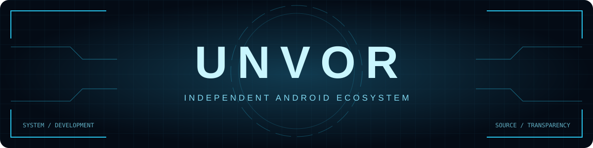

**Privacy-oriented Android software · Independent infrastructure · Transparent development**

[Italiano](docs/README.it.md) · [Español](docs/README.es.md) · [Documentation](docs/README.md)

[Chat releases](https://github.com/Jabo86/ultron-android/releases) · [Launcher source](https://github.com/Jabo86/ultron-android/tree/fix/unvor-launcher/unvor-launcher) · [Report a bug](https://github.com/Jabo86/ultron-android/issues/new/choose)

---

## An independent Android ecosystem

UNVOR is a project in development encompassing messaging, a custom Android launcher and independent relay infrastructure. The goal is to reduce dependence on Google Play services and centralized infrastructure while keeping security claims tied to reproducible evidence. GrapheneOS is the intended launcher environment; UNVOR is not an operating system or an official GrapheneOS product.

| Component | Purpose | Current availability |
| --- | --- | --- |
| **UNVOR Chat** | Android messaging client | [Source on main](src) · [Pilot releases](https://github.com/Jabo86/ultron-android/releases/tag/ratchet-pilot-66) |
| **UNVOR Launcher** | Custom Android home experience | [Development source](https://github.com/Jabo86/ultron-android/tree/fix/unvor-launcher/unvor-launcher); separate signed release not verified |
| **UNVOR Network** | Independent relay federation | [Development branch](https://github.com/Jabo86/ultron-android/tree/feature/global-node-federation); deployment and properties require validation |
| **UNVOR Web** | Multilingual product and documentation portal | Planned publication; no verified live URL |

## Downloads

**UNVOR Chat Pilot 366** — experimental prerelease for test accounts, not a stable production release. See its [release notes](https://github.com/Jabo86/ultron-android/releases/tag/ratchet-pilot-66) and [download & verification guide](docs/DOWNLOADS.md). The existing stable channel currently points to legacy ULTRON branding. Do not assume the newest pilot is compatible with an existing installation.

## Engineering and transparency

- [Architecture & component boundaries](docs/ARCHITECTURE.md)
- [Build & verification](docs/BUILD.md)
- [Security model & evidence](docs/SECURITY-MODEL.md)
- [Roadmap](docs/ROADMAP.md)
- [Contributing](CONTRIBUTING.md) · [Code of conduct](CODE_OF_CONDUCT.md)
- [Vulnerability reporting](SECURITY.md)

The Android client uses React Native and native Kotlin/Java modules. The existing application ID `com.ultron.messenger` and URI scheme `ultron://` remain unchanged by this documentation update. Technical migration history is preserved in [migration status](ULTRON_MIGRATION_STATUS.md) and [notification migration](ULTRON_NOTIFICATIONS_MIGRATION.md).

## License and provenance

This repository is **source-available under Business Source License 1.1**, not currently an unrestricted open-source distribution. The published [LICENSE](LICENSE) specifies a change date of 2030-09-06 and a change license of GPL-3.0-or-later. Relicensing is a project goal subject to rights and dependency review.

The original base derives from `Jabo86/lattice-android`, branch `ultron/android-migration`, commit `d282fec63b737b1b3d8de521f87b6560e88154a1`. See [NOTICE](NOTICE), [TRADEMARK](TRADEMARK.md), [DISCLAIMER](DISCLAIMER.md) and third-party licenses. Historical identifiers and attribution are intentionally retained.

*Development status: 24 November 2026. No independent security audit or production-readiness certification is asserted by this page.*
