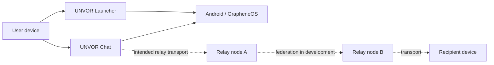

# Architecture and trust boundaries

This is a component-level overview, not a verified protocol specification.

- **Android / GrapheneOS:** OS-level permissions, sandboxing and platform security. UNVOR should not duplicate OS protections or imply that it replaces them.
- **Launcher:** home experience, navigation and local features; independently versioned from messaging.
- **Chat:** React Native and native Android client; its current namespace is `com.ultron.messenger`. The intended internal address book uses reciprocal UNVOR identifiers.
- **Relay network:** independent nodes and federation are design goals; retention, routing, failure handling and metadata visibility must be validated against the actual code and deployments.

The absence of a central server, zero metadata retention, absence of required Google services and end-to-end security must each be demonstrated for the specific release and deployment. They are not guaranteed by a diagram.

See the historical [migration status](../ULTRON_MIGRATION_STATUS.md), [notification migration](../ULTRON_NOTIFICATIONS_MIGRATION.md) and [call specification](../WEB_CALL_SPEC.md).
